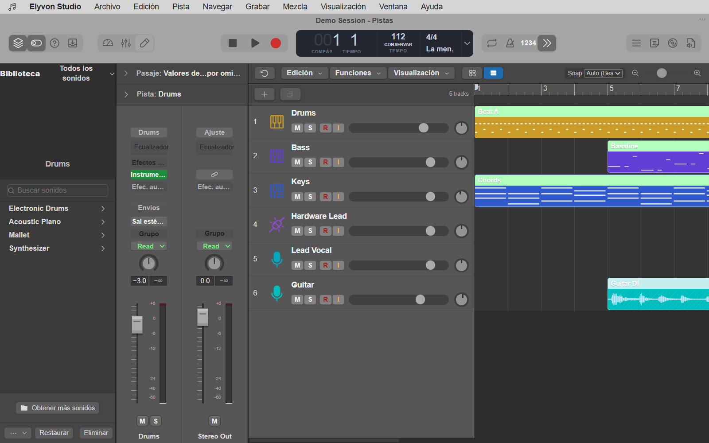
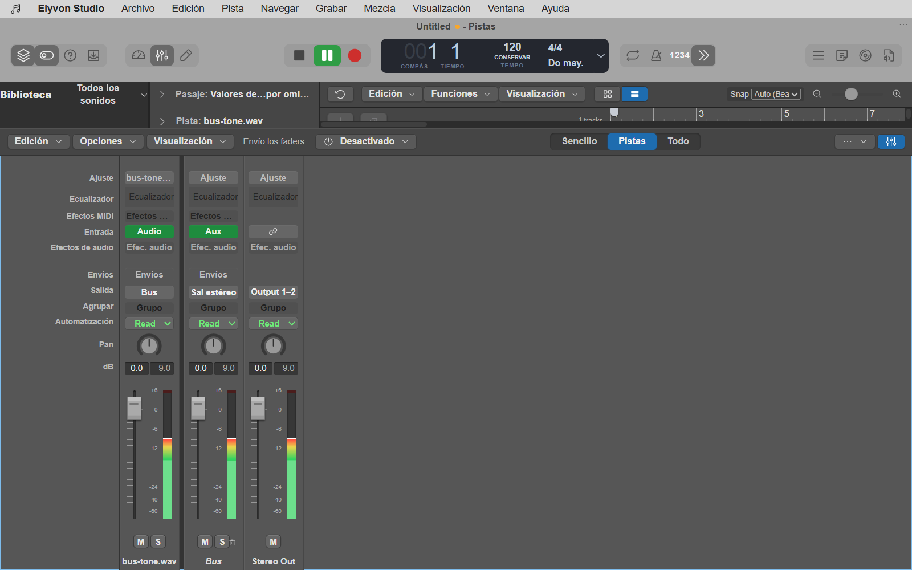
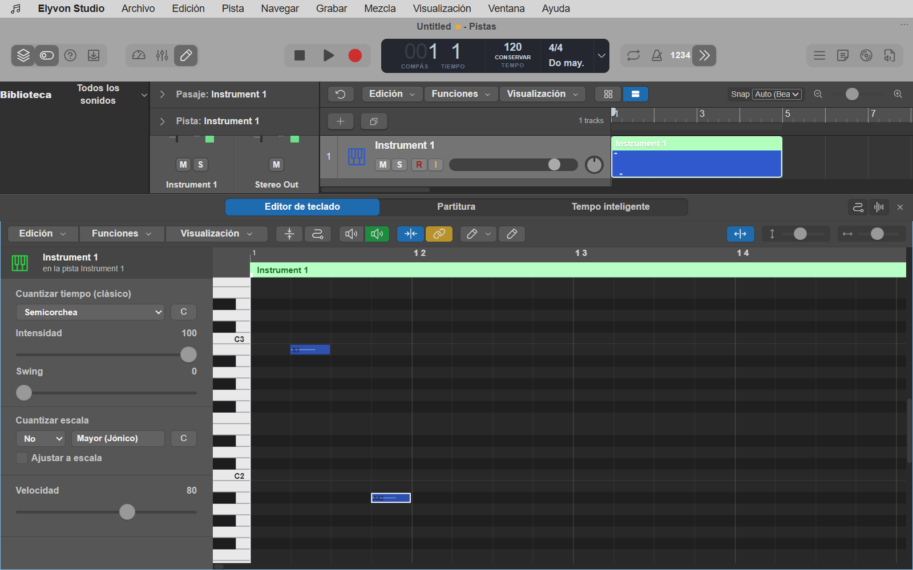
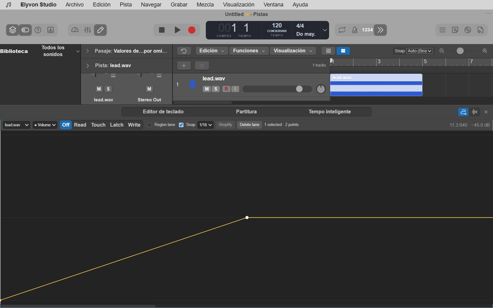
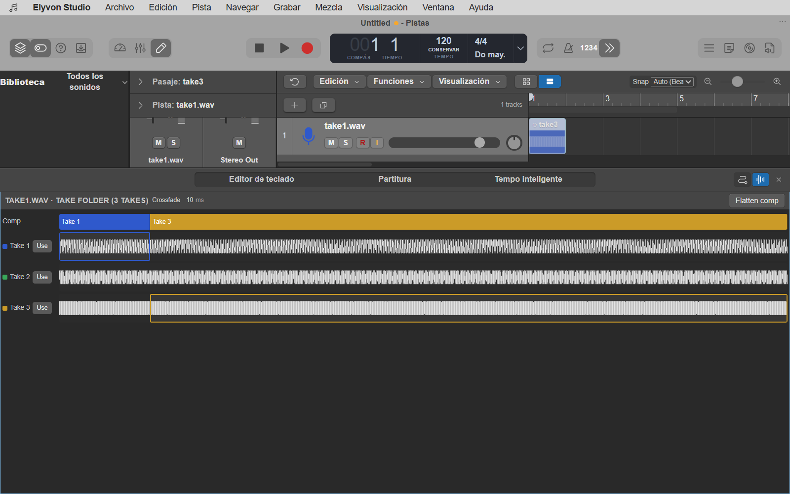

<p align="center">
  
</p>

<h1 align="center">Elyvon Studio</h1>

<p align="center">
  A desktop digital audio workstation built with <b>Rust</b>, <b>Tauri 2</b>, <b>React</b> and <b>TypeScript</b>.<br>
  Native, lock-free audio engine · non-destructive editing · sample-accurate automation
</p>

<p align="center">
  <a href="#download">Download</a> ·
  <a href="#features">Features</a> ·
  <a href="#development">Development</a> ·
  <a href="docs/README.md">Documentation</a> ·
  <a href="CHANGELOG.md">Changelog</a>
</p>



> **Status: 0.5.0 preview** (native effects, phases 12–13). Phases 02–13 are implemented and verified by Rust,
> frontend and native end-to-end tests on Windows 11 x64, where the audio has been confirmed by
> ear. A physical microphone/MIDI-keyboard session and device tests on every other platform are
> still pending, so the phases stay **PARTIAL**. Details: [STATUS](docs/STATUS.md) ·
> [feature matrix](docs/FEATURE_MATRIX.md) · [phase audits](docs/audit/README.md).

## Download

| Platform | Installer | |
| --- | --- | --- |
| **Windows x64** (64-bit Windows 10/11) | [EXE setup](https://github.com/atorcam102/ELYVON-STUDIO/releases/download/v0.4.1-windows-preview.1/Elyvon-Studio-v0.4.1-windows-x64-setup.exe) | [MSI](https://github.com/atorcam102/ELYVON-STUDIO/releases/download/v0.4.1-windows-preview.1/Elyvon-Studio-v0.4.1-windows-x64.msi) |

[Release notes](https://github.com/atorcam102/ELYVON-STUDIO/releases/tag/v0.4.1-windows-preview.1) ·
[SHA-256 checksums](https://github.com/atorcam102/ELYVON-STUDIO/releases/download/v0.4.1-windows-preview.1/SHA256SUMS.txt) ·
[all releases](https://github.com/atorcam102/ELYVON-STUDIO/releases)

Install **one** of the two: the EXE is the usual setup wizard; the MSI suits managed
deployments. Both contain the same application. The installers are built and checked on the
maintainer's Windows x64 laptop, not in CI. They are **unsigned** (no Authenticode, no updater
signature), so Windows SmartScreen may warn and automatic updates are off; compare the file's
SHA-256 with `SHA256SUMS.txt` before installing. Other operating systems and architectures are
not distributed.

## Features

| Area | What works today |
| --- | --- |
| **Projects** | `.elyvon` projects with atomic saves, Save As, unsaved-change prompts, crash recovery and schema migrations (1 → 6) |
| **Arrangement** | Audio, instrument and MIDI tracks; metre-aware snap; move, trim, split, glue, slip, ripple, marquee; fades and editable crossfades (equal power, linear, S-curve); reverse, normalise, slices at transients, bounce in place, track freeze |
| **Recording** | Armed audio inputs to recoverable WAV/BWF takes with count-in, pre-roll, punch and cycle; native MIDI 1.0 recording and routing; virtual keyboard |
| **Takes and comping** | Cycle passes become take folders; drag across takes in **Tomas y audio** to comp with centred crossfades; flatten and unflatten without touching the files |
| **Piano roll** | Draw, select, move, resize, erase; quantise with strength and swing, humanise, transpose, legato; velocity and controller lanes; multi-region editing |
| **Mixer** | Aux buses, pre/post-fader sends, native inserts (trim, filters, look-ahead limiter), delay compensation, groups, real peak/RMS meters, stem export |
| **Effects** | 16 native effects in Rust: parametric EQ with the engine's real curve and a measured spectrum, compressor and gate/expander with sidechain and gain-reduction meters, stereo utility, test generator, tempo-synced delay (tape, ping-pong), algorithmic and convolution reverbs, chorus, flanger, phaser, tremolo, rotary, distortion with oversampling, bitcrusher, pitch shifter; presets, A/B, automation; bounce identical to live playback |
| **Automation** | Volume, pan, mute, sends and insert parameters on tracks, buses, master and regions; Read/Touch/Latch/Write from the mixer; linear, step and Bézier curves; lane editor in **Automatización**; playback identical to export |
| **Media** | Project media dialog: find moved files by content, rescan, collect into the project folder, back up unused files before removing them |
| **Interface** | Spanish desktop chrome with menu bar, control bar, inspector, side panels (events, markers, tempo, metre, browsers, notes), bottom editors and keyboard shortcuts |

Not there yet: plug-in hosting, a sampler and production instruments, Flex time/pitch, Live
Loops, Smart Controls assignment, tempo analysis of audio, engraved rhythmic notation (the score
view is a simplified read-only one) and MIDI 2.0. Controls for these say «todavía no disponible».
The [roadmap](docs/ROADMAP.md) lists the next phases.

## Screenshots

| | |
| --- | --- |
|  |  |
| Mixer with an aux bus and live meters | Piano roll |
|  |  |
| Automation lane | Comping three takes |

Captured from the real application by the end-to-end suite on Windows 11 x64 —
[how and with which limits](docs/screenshots/README.md).

## Development

**Requirements:** Rust stable ≥ 1.90 with `x86_64-pc-windows-msvc`, Node.js ≥ 22.12, Visual
Studio Build Tools (C++) and WebView2 — see [Tauri's prerequisites](https://v2.tauri.app/start/prerequisites/).

```bash
npm ci
npm run tauri dev                          # app with hot reload
npm run check                              # versions, typecheck, lint, Vitest, build
npm run check:rust                         # fmt, clippy, workspace tests, binding drift
npm run tauri -- build --debug --no-bundle # native binary for the end-to-end suite
npm run test:e2e                           # WebDriver tests against that binary
```

[CONTRIBUTING](CONTRIBUTING.md) covers the end-to-end setup, the architecture rules (logic in
Rust, real-time safety, honest UI) and commit conventions. Building and publishing installers is
described in [RELEASES](docs/RELEASES.md).

### Repository layout

```text
crates/
  elyvon-core/       Musical time, tempo maps, grids, colours, atomic file writes
  elyvon-project/    Project model, edit commands, validation, undo history, .elyvon format
                     and migrations, automation recorder, comps, recovery
  elyvon-audio/      Real-time engine: playback plans, mixer graph, DSP inserts, automation
                     envelopes, recording, MIDI, media decoding/streaming, offline render
  elyvon-update/     Update policy, release manifests, artifact naming and the release CLI
src-tauri/           Desktop shell: IPC commands, audio host, menus, preferences, logging
src/
  features/          UI by area: topbar, timeline, tracks, inspector, mixer, editors,
                     browser, recording, midi, dialogs, settings, updates
  components/        Shared controls (buttons, fields, menus, icons)
  state/             Zustand stores (presentation state only; the model lives in Rust)
  lib/               Pure helpers shared with tests (tempo map, automation curves, IPC)
  bindings/          TypeScript types generated from Rust by ts-rs — do not edit
  styles/            Design tokens, layout and the reference chrome
  reference/         Design-reference pages (development only)
e2e/                 WebDriver end-to-end suite and native measurements
scripts/             Check, version, release-notes and artifact-collection tools
docs/                Status, architecture, contracts, format, ADRs, audits, screenshots
assets/brand/        Application icon sources
```

## Documentation

Start at the [documentation index](docs/README.md): status and support matrix, architecture,
decision records, contracts, the project format, release process and the audit of every phase.

## Privacy and licence

No telemetry. The update check uses the network and can be turned off in **Ajustes › Updates**.

© 2026 Elyvon. All rights reserved. No distribution licence has been chosen for this project
yet; see [third-party notices](THIRD_PARTY_NOTICES.md) for the licences of its dependencies.
