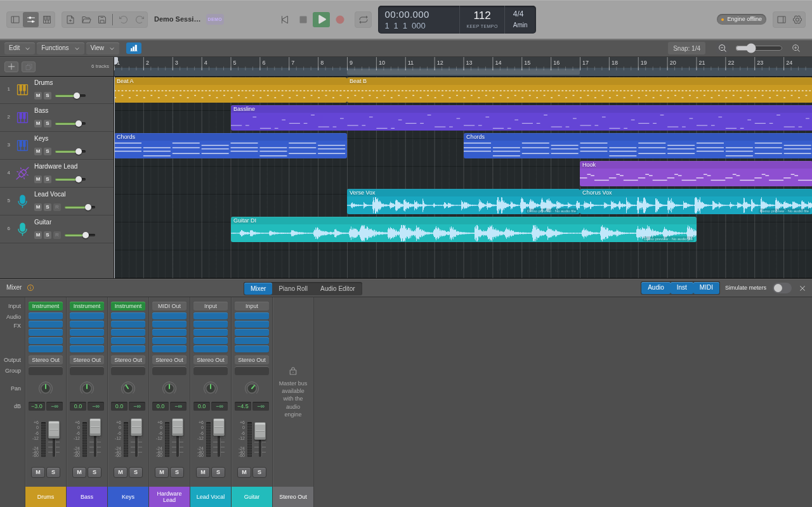
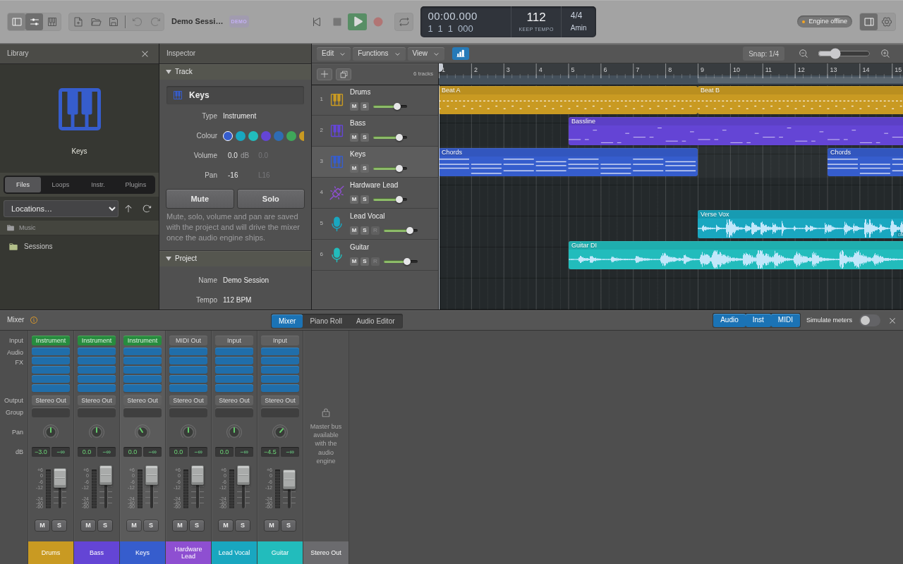
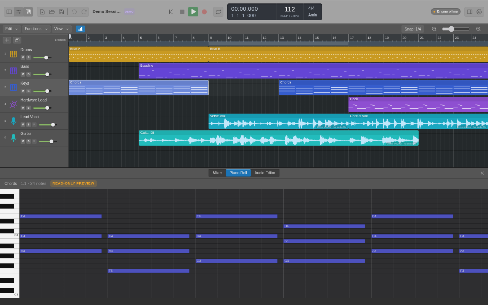

<p align="center">
  
</p>

# Elyvon Studio

[](https://github.com/atorcam102/ELYVON-STUDIO/actions/workflows/ci.yml)

Estación de trabajo de audio digital de escritorio en desarrollo, construida con **Rust, Tauri 2, React y TypeScript**. Actualmente permite organizar pistas y regiones, inspeccionar notas MIDI y gestionar proyectos `.elyvon`, con una interfaz de estudio en tonos grafito.

**Estado: v0.1.0 · Fase 1.** La gestión de proyectos y sus controles de edición están implementados. El motor de audio está pendiente: esta versión todavía no reproduce ni graba sonido.



*Interfaz actual de `main`: transporte con LCD, pistas por colores, regiones MIDI y mezclador. Las formas de onda de la demo son ilustrativas.*

[Descargas para Windows](#descargas-para-windows) · [Funcionalidades](#funcionalidades-actuales) · [Más capturas](#capturas-de-la-interfaz) · [Desarrollo](#desarrollo)

## Funcionalidades actuales

| Área | Qué puedes hacer ahora |
| --- | --- |
| **Proyectos** | Crear, abrir y guardar proyectos `.elyvon`; usar Guardar como y conservar nombres, pistas, regiones y ajustes musicales. |
| **Historial y recuperación** | Deshacer y rehacer ediciones, recibir avisos de cambios sin guardar y recuperar instantáneas tras un cierre inesperado. El guardado de archivos es atómico. |
| **Pistas** | Crear pistas de audio, instrumento y MIDI; renombrar, duplicar, eliminar, reordenar, cambiar colores y seleccionar varias pistas. |
| **Arreglo** | Navegar por compases, mover el cursor, ajustar el zoom y trabajar con cuadrícula y snap. Mover regiones en el tiempo o entre pistas compatibles y crear regiones MIDI vacías. |
| **Ajustes musicales** | Cambiar tempo, compás y tonalidad; definir y editar el rango de ciclo del proyecto. |
| **Mezclador** | Editar volumen, panorama, mute y solo por pista. Estos valores se guardan en el proyecto; todavía no procesan señal de audio. |
| **Piano roll** | Inspeccionar las notas de una región MIDI y su distribución en el tiempo. Es una vista previa de solo lectura. |
| **Biblioteca de archivos** | Explorar carpetas y abrir proyectos `.elyvon` desde la barra lateral izquierda. |
| **Espacio de trabajo** | Mostrar, ocultar y redimensionar biblioteca, inspector y editores; alternar entre mezclador y piano roll. |
| **Controles de escritorio** | Usar menús nativos, atajos de teclado, preferencias y registros de diagnóstico. |
| **Sesión de demostración** | Explorar un arreglo de seis pistas: Drums, Bass, Keys, Hardware Lead, Lead Vocal y Guitar. Los proyectos nuevos empiezan vacíos. |

### Qué sigue pendiente

- Reproducción, grabación y selección de dispositivos de audio.
- Importación y edición de archivos de audio; exportación y bounce.
- Entrada/salida MIDI y edición de notas en el piano roll.
- Instrumentos integrados, sampler, efectos, buses y hosting de plug-ins.
- Biblioteca de loops con escucha previa.

Los controles de reproducción y grabación permanecen deshabilitados cuando el motor no está disponible. Los slots de efectos son espacios visuales sin procesamiento. Los medidores solo se animan al activar explícitamente **Simulate meters**.

El repositorio incluye infraestructura de actualizaciones con validación de versión, plataforma y firma. La preview sin firma publicada actualmente **no activa actualizaciones automáticas**. Consulta [releases y firmas](docs/RELEASES.md) para su configuración.

## Capturas de la interfaz

### Biblioteca e inspector

Biblioteca a la izquierda, propiedades de la pista seleccionada y controles del proyecto junto al arreglo.



### Vista previa del piano roll

Las notas de la región **Chords** de Keys se muestran debajo del arreglo. La indicación **READ-ONLY PREVIEW** identifica el alcance actual del editor.



Las capturas muestran el frontend principal de `main` renderizado en Chromium a **1280 × 800**, con el puente de prueba oficial de Tauri y los datos de la sesión demo. No son capturas del instalador de Windows. [Detalles de las capturas](docs/screenshots/README.md).

## Descargas para Windows

La distribución actual se centra en **Windows x64 y x86**.

| Arquitectura | Instalador EXE | Instalador MSI |
| --- | --- | --- |
| **Windows x64 · 64 bits** | [Descargar EXE](https://github.com/atorcam102/ELYVON-STUDIO/releases/download/v0.1.0-windows-preview.1/Elyvon-Studio-v0.1.0-windows-x64-setup.exe) | [Descargar MSI](https://github.com/atorcam102/ELYVON-STUDIO/releases/download/v0.1.0-windows-preview.1/Elyvon-Studio-v0.1.0-windows-x64.msi) |
| **Windows x86 · 32 bits** | [Descargar EXE](https://github.com/atorcam102/ELYVON-STUDIO/releases/download/v0.1.0-windows-preview.1/Elyvon-Studio-v0.1.0-windows-x86-setup.exe) | [Descargar MSI](https://github.com/atorcam102/ELYVON-STUDIO/releases/download/v0.1.0-windows-preview.1/Elyvon-Studio-v0.1.0-windows-x86.msi) |

[Ver la release y sus notas](https://github.com/atorcam102/ELYVON-STUDIO/releases/tag/v0.1.0-windows-preview.1) · [Hashes SHA-256](https://github.com/atorcam102/ELYVON-STUDIO/releases/download/v0.1.0-windows-preview.1/SHA256SUMS.txt)

La preview enlazada se compiló desde `40acb8e`. **Las capturas muestran el rediseño posterior de `main`**, que requiere un nuevo instalador para aparecer en esa descarga. Los binarios de esta preview no tienen firma de actualización ni firma Authenticode.

La [CI actual](.github/workflows/ci.yml) genera instaladores EXE y MSI para Windows x64/x86. El repositorio también conserva configuración para otras plataformas; su distribución queda fuera del alcance actual.

## Primeros pasos

1. Abre Elyvon Studio y crea un proyecto o elige **Or explore the demo session** en el arreglo vacío. También puedes abrir la demo desde el menú nativo **File**.
2. Añade pistas desde **Functions** o el botón **+**. Usa el inspector para ver sus propiedades.
3. Selecciona y organiza regiones en el arreglo. En pistas de instrumento o MIDI, un doble clic sobre el espacio vacío crea una región MIDI.
4. Ajusta volumen, panorama, mute y solo en el mezclador. Selecciona una región MIDI y abre **Piano Roll** para inspeccionar sus notas.
5. Guarda el proyecto como archivo `.elyvon`.

### Atajos principales en Windows

| Acción | Atajo |
| --- | --- |
| Nuevo / abrir proyecto | `Ctrl+N` / `Ctrl+O` |
| Guardar / guardar como | `Ctrl+S` / `Ctrl+Shift+S` |
| Deshacer / rehacer | `Ctrl+Z` / `Ctrl+Shift+Z` o `Ctrl+Y` |
| Duplicar pistas | `Ctrl+D` |
| Eliminar selección | `Delete` |
| Inspector / biblioteca / editores | `I` / `B` / `E` |
| Mezclador | `X` |
| Activar o desactivar el rango de ciclo | `L` |
| Llevar el cursor al inicio | `Home` |

La lista completa está en **Settings → Shortcuts**.

## Desarrollo

### Requisitos

- **Node.js 22.12 o superior** y npm.
- **Rust estable 1.88 o superior**.
- Para Windows: herramientas de compilación de C++ de Microsoft y WebView2, según los [requisitos de Tauri](https://v2.tauri.app/start/prerequisites/).
- Las dependencias nativas de otros entornos de desarrollo se describen en [CONTRIBUTING](CONTRIBUTING.md).

### Ejecutar la aplicación

```bash
npm ci
npm run tauri dev
```

Este comando inicia Vite y la aplicación de escritorio con su puente nativo.

### Comprobaciones y compilación

```bash
npm run typecheck
npm run lint
npm test
npm run build                 # frontend de producción
cargo test --workspace        # pruebas Rust y regeneración de bindings
npm run tauri -- build --no-bundle  # aplicación nativa sin instaladores
```

La generación y publicación de instaladores está documentada en [RELEASES](docs/RELEASES.md).

### Referencia visual

La página `/reference.html`, accesible con `npm run dev`, conserva maquetas de Live Loops, secuenciador y acordes para comparar diseños. **Son vistas de referencia con datos estáticos**, no funciones de producción de la aplicación principal.

## Estructura del repositorio

```text
crates/elyvon-core/      Tiempo musical, colores y escritura atómica
crates/elyvon-project/   Modelo de proyecto, formato .elyvon, historial y recuperación
crates/elyvon-audio/     Contratos del futuro motor de audio
crates/elyvon-update/    Política de actualizaciones, manifiestos y CLI de releases
src-tauri/              Aplicación de escritorio, IPC, menús y preferencias
src/features/           Transporte, pistas, arreglo, mezclador, inspector y biblioteca
src/components/         Controles compartidos de la interfaz
src/styles/             Tema, disposición y estilos del diseño actual
src/reference/          Maquetas visuales de referencia
e2e/                    Pruebas contra el binario real mediante WebDriver
docs/screenshots/       Capturas del frontend actual
```

## Documentación

- [Arquitectura](docs/ARCHITECTURE.md)
- [Formato de proyecto `.elyvon`](docs/PROJECT_FORMAT.md)
- [Releases, firma y actualizaciones](docs/RELEASES.md)
- [Roadmap](docs/ROADMAP.md)
- [Contribuir](CONTRIBUTING.md)
- [Changelog](CHANGELOG.md)

## Privacidad y licencia

Sin telemetría. La comprobación de actualizaciones utiliza la red y puede desactivarse en **Settings → Updates**.

© 2026 Elyvon. Todos los derechos reservados. Todavía no se ha establecido una licencia de distribución para el proyecto.
